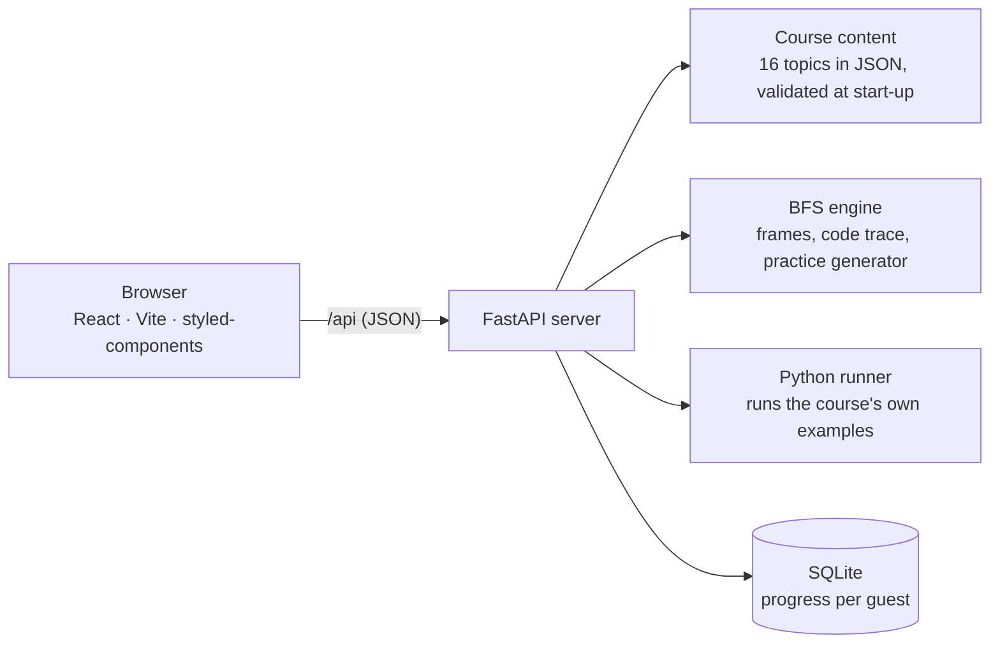

# COS212 · Graphs and BFS

**A pre-lecture tutor that takes COS212 students from "what's a graph?" to tracing breadth-first search by hand, before the lecture starts.**

Built by **Bridge2Understanding** for the COS750 (Educational Software Development) exam at the University of Pretoria, 2026.

> **Live app:** [cos-212-app.onrender.com](https://cos-212-app.onrender.com) · **Run locally:** see [Getting started](#getting-started)
>
> The live app is on Render's free tier, so the first visit after a quiet spell can take up to a minute while the server wakes up.

---

## Why this app exists

Lectures on graph algorithms often move fast. Students who arrive without the vocabulary spend the lecture catching up on what a vertex is or how a queue works, instead of understanding the algorithm.

This app is the step before the lecture. In about **35 minutes**, a student with **no prior knowledge** of graphs or BFS learns:

- what an **undirected, unweighted graph** is, and how Python stores one
- how a **queue** works (first in, first out)
- how **breadth-first search** explores a graph one "ripple" at a time
- how BFS finds the **route with the fewest stops**, and why some places can't be reached

They arrive at the lecture with the basics in place, a clear picture of what they still find hard, and questions to ask.

## Who it's for

- **COS212 students** meeting graphs and BFS for the first time. No login and no prior knowledge needed. It helps to know what a Python list is.
- **Lecturers**: the readiness report shows what students understood and what they want to ask, so the lecture can start in the right place.

## The learning journey

One running example is used throughout: a small **campus graph**. Six buildings (Library, Café, Lab, Gym, Res, Clinic) are joined by five walkways. The Clinic has none, so it can't be reached.

| Module | Topics | The student can then… |
|---|---|---|
| **1 · Welcome and warm-up** | Introduction video · How this course works · Warm-up quiz (no marks) | Say what question the course answers, and record a starting point |
| **2 · Graph foundations** | From a map to a graph · Places, lines and neighbours · Lines that go both ways · Storing a graph in Python · Check | Name vertices, edges and neighbours; explain undirected and unweighted; count hops; read an adjacency list |
| **3 · Breadth-first search** | The café queue · Ripple outward · Mark a place when it's found · Predict the next step · Check | Trace BFS with a queue step by step, and explain why a place is marked when it joins the queue |
| **4 · Shortest routes and lecture check** | Retrace the route · Places you can't reach · Lecture-ready check | Rebuild the fewest-stops route from parent links, spot unreachable places, and see their readiness |

16 topics in total. Each one states its goal at the top and ends with a recap.

## Learn it your way

Every topic offers several ways in. The student picks what helps, in any order:

| Way | What it looks like |
|---|---|
| **Watch** | Short animations with captions, chapters, speed control and a full transcript |
| **Listen** | A speaker icon on every paragraph: press to hear it read aloud, press again to stop |
| **Read** | Short notes, one idea per paragraph, with key words explained in plain English |
| **Try** | Predict each BFS step on the campus map and get instant feedback |
| **Code** | Step through real Python line by line and watch the queue and variables change |
| **Practise** | Endless generated questions at three levels: Warm-up, Standard and Challenge |

Written answers can be **typed or spoken** (voice input in Chrome or Edge).

## How it checks understanding

Assessment is formative and low-stakes. It's there to guide learning, not to grade it.

1. **Warm-up (1.3).** Six no-marks questions record where the student starts.
2. **Checks after each module.** Wrong answers get a "Not yet" message that names the likely misconception, such as serving the newest place (stack order) instead of the oldest (queue order), or counting places instead of edges.
3. **Scaffolding when stuck.** First a hint, then a second hint, then a replay of that exact step in the animation.
4. **Confidence ratings.** Students say how sure they are before answering. Being sure but wrong flags a misconception worth raising in the lecture.
5. **Lecture-ready check (4.3).** Six questions mapped to the five course objectives. The **readiness report** marks each objective *Ready* or *Review* and links to the topic to revisit. It compares the student with their own warm-up ("Warm-up: 2 of 6. Now: 5 of 6"), never with other students.

Readiness is based on **answers only**. Time spent on the app never counts as mastery.

## Planning and reflection

- **Dashboard:** module progress, a study calendar, a to-do list, a focus timer and a lecture-ready checklist.
- **My analysis:** how the student has spent their time (watching, listening, reading, trying, coding, practising), concept-by-concept accuracy, study suggestions and a short plan for before the lecture.

## Learning design in brief

| Principle | Where it shows up |
|---|---|
| Merrill's First Principles | Activate (campus problem) → demonstrate (animation) → apply (predict, code, practise) → integrate (explain in your own words, lecture questions) |
| Constructivism | Students predict each step before seeing it, then check |
| Cognitive load | One idea per screen, everyday words before formal terms, the queue drawn on screen |
| Learning preferences (VARK, Kolb) | Watch, listen, read, try and code routes all lead to the same objectives. Preferences are treated as flexible, not as fixed labels. |
| Motivation (Malone and Lepper, flow) | Curiosity, choice of path, challenge levels, immediate feedback, no timers and no leaderboards |
| Constructive alignment | Each of the 5 objectives (tagged with CS2023 levels: Explain, Apply, Evaluate) has teaching activities and an assessment item |
| Universal Design for Learning | Several ways to engage, see content, and respond, for every learner |

The full rationale is in the group's Instructional Design and Software Engineering documents.

## Accessibility

- Every control is a real button, link or input with a label. Touch targets are at least 44 px. Everything works with the keyboard (skip link, arrow keys in the calendar and tabs).
- Nothing relies on colour alone: served places show a tick, waiting places show a clock and a dashed border, and feedback is given in words.
- Text alternatives everywhere: captions and transcripts, a live announcement per animation chapter, and "the map in words".
- Read-aloud on every paragraph (South African English voice), voice answers, and no timers on questions.
- **Settings:** text size, dyslexia-friendly (Lexend) and low-vision (Atkinson Hyperlegible) fonts, wide spacing, dark, light and high-contrast themes, letter or place-name labels, slow or step-by-step animation, reduced motion (also follows the device setting), captions and read-aloud speed.
- Settings are worded so nobody has to explain why they use them.

---

## How it's built

One server, one address: FastAPI serves both the course API and the built React front end at **http://localhost:8000**.



| Part | Folder | Responsibility |
|---|---|---|
| Back end | `backend/` | Python · FastAPI · SQLite. Validated course content, BFS, code tracing, running the course's Python examples, practice questions, answer checking, saved progress, the readiness report and My analysis. |
| Front end | `frontend/` | React · Vite · styled-components. Display only: it holds no course content and no answers. Answers are checked on the server. |

**Design choices**

- **Content is data.** All 16 topics live in JSON and are checked against a schema when the server starts. If anything is inconsistent, such as an answer index out of range, a link to a missing topic, or a trace step past the end of BFS, the server refuses to start and says exactly what to fix.
- **One source of truth for BFS.** The animations, the map, the code tracer and the practice questions all come from the same back-end BFS, so they can never disagree.
- **Safe code running.** Only code written in the course content is ever run, each time in a separate process with a time limit. Students can't send code to the server.
- **No login.** Each browser gets an anonymous guest id.

## Getting started

You need **Python 3.10+** and **Node.js 20+**.

**Windows (PowerShell or the VS Code terminal), from the project folder:**

```powershell
.\run.ps1
```

**macOS / Linux:**

```bash
./run.sh
```

The first run sets everything up: a Python virtual environment, the packages and the front-end build. Then open **http://localhost:8000**.
Next time, `.\run.ps1 -SkipBuild` starts faster if you haven't changed the front end.

| Address | What |
|---|---|
| http://localhost:8000 | The app |
| http://localhost:8000/docs | Interactive API documentation |
| http://localhost:8000/api/health | Health check |

### Developing with live reload

```powershell
# terminal 1: back end
cd backend
.venv\Scripts\Activate.ps1
uvicorn app.main:app --reload --port 8000

# terminal 2: front end (http://localhost:5173, forwards /api to :8000)
cd frontend
npm run dev
```

### Tests and checks

```powershell
cd backend;  python -m pytest -q     # content, BFS, answers, readiness rules, API
cd frontend; npm run lint            # ESLint
```

The tests check, among other things, that every quiz answer about BFS matches the real algorithm and that every Python example in the course runs and prints what the lesson says.

## Project layout

```
backend/
  app/
    main.py              FastAPI app: API routes, /docs, serves frontend/dist at /
    db.py                SQLite storage per guest (data/cos212.db, created on first run)
    content/
      course.json        overview, modules, objectives (CS2023 levels), glossary, checklist
      modules/*.json     the 16 topics: goal, animation scenes, notes, words, examples, code, labs, quizzes
      models.py          Pydantic schema: content is validated at start-up
      loader.py          loads and cross-checks content; strips answers before sending to the browser
    core/
      graph.py           campus graph, BFS frames, DFS, line-by-line code trace
      practice.py        endless practice generator (3 levels)
      runner.py          runs the course's own Python examples in a separate process
      checker.py         checks answers and returns "Not yet" feedback
      analysis.py        readiness report (4.3) and My analysis
    routers/             content, graph, practice, learners (state, answers, report, analysis)
  tests/
frontend/
  src/
    api/                 API client, sync to server, learner actions
    context/             course (from server), settings, speech (read-aloud), page
    components/shell/    sidebar, top bar, theme switch, solar-system background, error boundary
    components/dashboard/
    components/topic/    animation player, campus map, IDE, labs, quizzes
    components/ui/       icons, buttons, pixel radio, wave checkbox, slider switch, astronaut
    pages/               Dashboard, Topic (any of the 16), Course overview, My analysis, Settings
run.ps1 / run.sh         one command to set up and run
```

## Editing course content

Edit `backend/app/content/modules/moduleN.json` and restart the server. The schema check and `pytest` will catch mistakes before students see them.

## Your data

Progress is saved per guest on the server, and in the browser for offline use. That covers progress, topics, plans, to-dos, study-time tracking, questions and settings. Answers are written by the server only. Time tracking stays with the student and can be switched off. **Settings → "Clear all my progress and data"** removes everything.

## Known limitations

- The lecture date shown ("Thu 19 Nov") is an example.
- Translations of key words into other South African languages are marked "to be checked" until a first-language speaker reviews them.
- Voice answers need a browser with speech recognition (Chrome or Edge). Typing always works.
- The graph is fixed (the campus example). There is no graph editor.

## Acknowledgements

COS750 Educational Software Development, University of Pretoria, 2026. Course design draws on the COS750 lecture series and on CS2023: graphs are in AL-Foundational and BFS is in AI-Search, both CS Core. Generative AI tools used during design and development are acknowledged, with their prompts, in the group's Instructional Design document.
